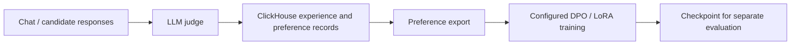

# Second Me Evolve

**Preference-data collection and DPO orchestration built on Mindverse's Second Me.**

This is a derivative of [Mindverse/Second-Me](https://github.com/Mindverse/Second-Me),
not an independently created replacement for the upstream system. The extensions
focus on connecting chat interactions, LLM-based judging, persistent preference
records and a configurable training workflow.

## What this repository adds

- A/B response evaluation with a configurable LLM judge and preference records.
- ClickHouse storage for chat experiences, preferences and feedback.
- Dataset export and DPO/LoRA training components.
- A scheduler with minimum-pair, interval, lock and state-file controls.
- Integration with the upstream memory, chat UI and local-model workflow.



These components establish an experimental feedback pipeline. They do not by
themselves demonstrate that a fine-tuned model improves, that judge preferences
match human preferences, or that every chat mode takes the same A/B path.

## Implementation map

| Component | Source |
|---|---|
| Judge integration | [judge_llm_service.py](lpm_kernel/api/services/judge_llm_service.py) |
| Experience/preference persistence | [clickhouse_store.py](lpm_kernel/api/domains/kernel2/services/clickhouse_store.py) |
| Chat generation and experience logging | [chat_service.py](lpm_kernel/api/domains/kernel2/services/chat_service.py) |
| Scheduled export/training | [reinforce_scheduler.py](lpm_kernel/api/domains/kernel2/services/reinforce_scheduler.py) |
| DPO training | [dpo_train.py](lpm_kernel/L2/dpo/dpo_train.py) |
| Training details | [DPO documentation](lpm_kernel/L2/dpo/README.md) |

## Configuration matters

The scheduler's **Python default is disabled**: it starts only when
`AUTO_REINFORCE_DPO_ENABLED=1`. However, the checked-in
[docker-compose.yml](docker-compose.yml) explicitly sets this variable to `1`
for the backend. The Compose deployment therefore enables the scheduler unless
that setting is changed.

For a chat/data-collection demonstration without scheduled training, set the
backend's Compose environment entry to:

```text
AUTO_REINFORCE_DPO_ENABLED=0
```

Review the selected Compose file before starting it. Other scheduler settings
include `AUTO_REINFORCE_INTERVAL_SEC`, `AUTO_REINFORCE_MIN_PAIRS`,
`AUTO_REINFORCE_BASE_MODEL_PATH` and `AUTO_REINFORCE_OUTPUT_DIR`.
The Python scheduler falls back to a local Qwen2.5-3B-Instruct model path;
model availability and training hardware must be configured separately.

## Start the application

Use Docker Desktop or a compatible Docker Compose installation. Review backend
provider settings and the scheduler flag above before running:

```bash
git clone https://github.com/Maxi-online/second-me-evolve.git
cd second-me-evolve
docker compose up -d clickhouse
docker compose up -d --build backend frontend
```

The UI is at `http://localhost:3000`. Check both
[CPU/default Compose](docker-compose.yml) and
[GPU Compose](docker-compose-gpu.yml) for their actual environment and secret-file
configuration. They are separate deployment variants, not evidence of a completed
training run.

Upstream configuration guidance is retained in [docs](docs) and
[CONTRIBUTING.md](CONTRIBUTING.md).

## Evaluation status

The repository contains collection, persistence and training code. A completed
training run, held-out preference win rate and real model-quality improvement
are not established by the repository description. A meaningful evaluation should
freeze prompts and judge settings, keep evaluation pairs out of training, compare
the same base/checkpoint under the same generation budget and inspect disagreement
with human judgements.

## Licensing and attribution

Upstream Second Me code remains under [Apache License 2.0](LICENSE).
[NOTICE](NOTICE) records attribution. [LICENSE-MIT](LICENSE-MIT) applies to the
new contributions covered by that file; it does not relicense upstream code.

## Configuration, privacy and reproducibility

This work derives from upstream Second Me; component attribution and licenses are retained. Keep personal memories, embeddings, access tokens and personal-training outputs outside Git. Python defaults `AUTO_REINFORCE_DPO_ENABLED` to `0`, while the current Docker Compose sets it to `1`; explicitly review or disable automatic training before starting the stack.

Keep credentials in ignored local files or environment variables. Configuration examples contain structure only. Avoid passing secrets on the command line or committing populated `.env` files, private keys, databases or logs.

The [Secret scan](.github/workflows/secret-scan.yml) workflow scans current files and incoming commits with Gitleaks 8.30.1 and redacts matched values. Pattern scanning cannot prove that every possible disclosure is absent. Removing a value from HEAD does not clean older history; see [SECURITY.md](SECURITY.md) for incident handling.
